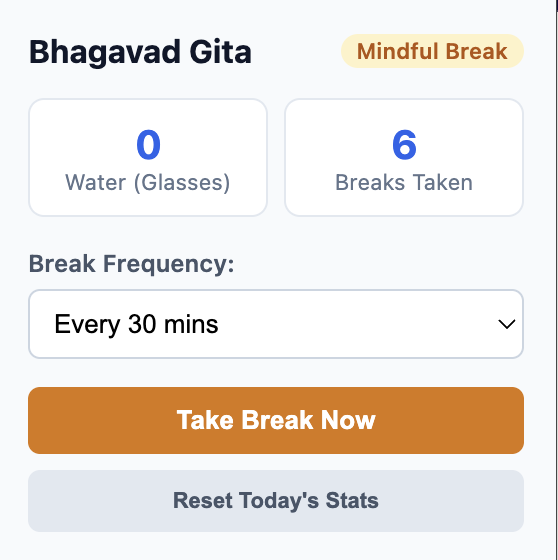
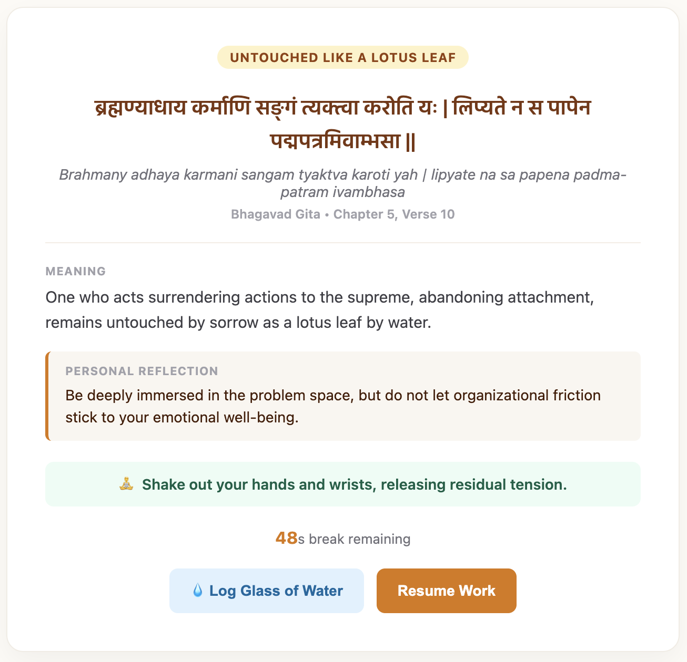

# 🪷 Bhagavad Gita Break Timer

A mindful desktop break and habit-tracking Chrome extension built with Manifest V3 and Vanilla JavaScript.

## 💡 Features
1. **Mindful Micro-Breaks:** Schedules automated desk breaks using `chrome.alarms`.
2. **Curated Shlokas:** Serves 58 curated Bhagavad Gita verses focused on equanimity, outcome detachment, focus, and posture.
3. **Random Deck Engine:** Implements a shuffle queue via `chrome.storage.local` to ensure zero verse repetition until all 58 are experienced.
4. **Desk Ergonomics & Hydration:** Built-in glass logging and physical posture prompts.
5. **100% Offline & Private:** Zero external servers, zero tracking, and runs completely locally.
## 💡 Features
1. **Mindful Micro-Breaks:** Schedules automated desk breaks using `chrome.alarms`.
2. **Curated Shlokas:** Serves 58 curated Bhagavad Gita verses focused on equanimity, outcome detachment, focus, and posture.
3. **Random Deck Engine:** Implements a shuffle queue via `chrome.storage.local` to ensure zero verse repetition until all 58 are experienced.
4. **Desk Ergonomics & Hydration:** Built-in glass logging and physical posture prompts.
5. **100% Offline & Private:** Zero external servers, zero tracking, and runs completely locally.

## 📸 Preview

<table align="center">
  <tr>
    <td align="center" width="35%">
      <b>Toolbar Control Popup</b>  
      
    </td>
    <td align="center" width="65%">
      <b>Mindful Reset Tab (Full Screen)</b>  
      
    </td>
  </tr>
</table>

## ⬇️✨ Installation (Developer Mode)
1. Clone this repository:
   git clone [https://github.com/Venkat-rkv/bhagavad-gita-break-timer.git]
2. Open Chrome and navigate to chrome://extensions/.
3. Enable Developer mode in the top-right corner.
4. Click Load unpacked and select the cloned project folder.

## 📌 Pinning & Using the Extension
1. Click the Extensions menu icon (the puzzle piece) in your Chrome toolbar.
2. Find Bhagavad Gita Break Timer and click the Pin icon next to it so it stays visible in your toolbar.
3. Click the extension icon to:
   - View your current daily break count and logged water glasses.
   - Adjust your break frequency (20, 30, 45, or 60 minutes).
   - Click Take Break Now to manually trigger a mindful reset screen at any time.
  
## 🛠️ How to Update to the Latest Version
If changes or new verses are added to the repository:
1. Pull the latest commits (git pull) or re-download the latest ZIP.
2. Go to chrome://extensions/.
3. Find Bhagavad Gita Break Timer and click the Reload (circular arrow) icon.

2. Open Chrome and navigate to chrome://extensions/.
3. Enable Developer mode in the top-right corner.
4. Click Load unpacked and select the cloned project folder.

## 📌 Pinning & Using the Extension
1. Click the Extensions menu icon (the puzzle piece) in your Chrome toolbar.
2. Find Bhagavad Gita Break Timer and click the Pin icon next to it so it stays visible in your toolbar.
3. Click the extension icon to:
   - View your current daily break count and logged water glasses.
   - Adjust your break frequency (20, 30, 45, or 60 minutes).
   - Click Take Break Now to manually trigger a mindful reset screen at any time.
  
## 🛠️ How to Update to the Latest Version
If changes or new verses are added to the repository:
1. Pull the latest commits (git pull) or re-download the latest ZIP.
2. Go to chrome://extensions/.
3. Find Bhagavad Gita Break Timer and click the Reload (circular arrow) icon.

